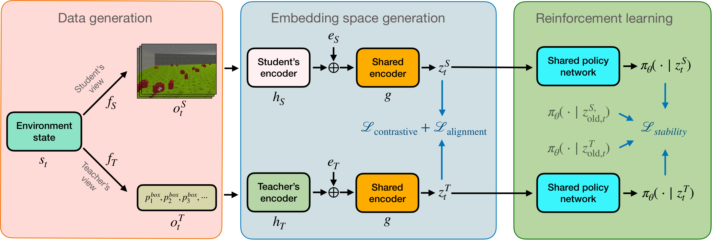
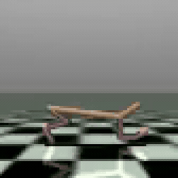
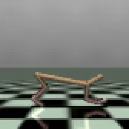
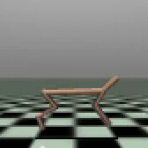
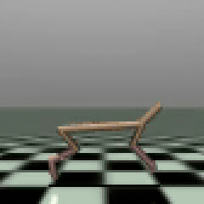
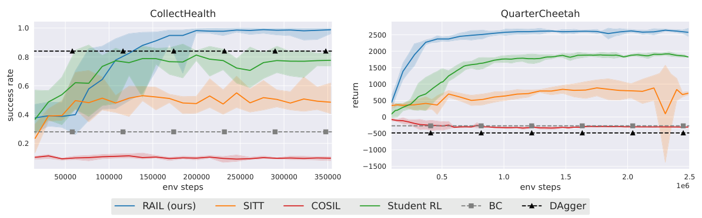

# RAIL: Representation-Aligned Imitation Learning for Student-Compatible Teacher Policies (NeurIPS 2026)

[Meraj Mammadov](https://merajmammadov.com/), [Pedro Zuidberg Dos Martires](https://pedrozudo.github.io/), and [Johannes A. Stork](https://scholar.google.com/citations?user=4HtJjKAAAAAJ&hl=en).

[Paper](https://openreview.net/pdf?id=DEj92qDbTo)
 · 
[Project page](https://merajmammadov.com/rail/)
 · 
[OpenReview](https://openreview.net/forum?id=DEj92qDbTo)

A teacher with access to privileged state information may learn behaviors that a student cannot imitate from its limited observations.

RAIL learns a common representation of teacher and student observations and trains the teacher policy in this space. At deployment, the student uses the same policy with its own encoder, without additional RL fine-tuning.

<p align="center">
  <a href="assets/architecture.pdf"></a>
</p>

## QuarterCheetah

QuarterCheetah adapts [HalfCheetah](https://gymnasium.farama.org/environments/mujoco/half_cheetah/), where the agent controls six joint torques to run forward. The teacher receives joint positions and velocities, while the student receives four stacked RGB frames with **the left half of each image hidden**.

The standard RL teacher learns a gait that the student cannot reliably imitate from the visible half of the image. The RAIL teacher learns a **symmetric gait**, which allows the student to infer hidden motion from the visible half and reproduce the teacher’s behavior.

<div align="center">
<table align="center">
  <tr>
    <td align="center" width="250">
      <strong>RL teacher</strong><br>
      <a href="assets/privileged-teacher.mp4"></a><br>
    </td>
    <td align="center" valign="middle" width="100"></td>
    <td align="center" width="250">
      <strong>Behavior-cloned student</strong><br>
      <a href="assets/bc-student.mp4"></a><br>
    </td>
  </tr>
  <tr>
    <td align="center" width="250">
      <strong>RAIL teacher</strong><br>
      <a href="assets/rail-teacher.mp4"></a><br>
    </td>
    <td align="center" valign="middle" width="100"></td>
    <td align="center" width="250">
      <strong>RAIL student</strong><br>
      <a href="assets/rail-student.mp4"></a><br>
    </td>
  </tr>
</table>
</div>

## Learning curves

RAIL outperforms imitation-learning baselines and direct Student RL, while maintaining a small teacher–student imitation gap. The student inherits the shared policy without additional RL fine-tuning.



*Student evaluation on CollectHealth and QuarterCheetah. Results from the paper.*

## Installation

Requires Python 3.11 or 3.12.

```bash
python3.11 -m venv .venv
source .venv/bin/activate
pip install -e .
```

## Training

Train RAIL on QuarterCheetah:

```bash
python train.py --config configs/quarter_cheetah.yaml --seed 0 --device cuda --output runs/quarter-cheetah-0
```

For a quick installation check:

```bash
python train.py --smoke --device cpu --output runs/smoke
```

## Evaluation

Evaluate the teacher and student on 100 episode seeds:

```bash
python evaluate.py --run runs/quarter-cheetah-0 --episodes 100 --seed 10000 --device cuda
```

Metrics and checkpoints are saved in the run directory.

## Citation

```bibtex
@inproceedings{mammadov2026rail,
  title={RAIL: Representation-Aligned Imitation Learning for Student-Compatible Teacher Policies},
  author={Mammadov, Meraj and Zuidberg Dos Martires, Pedro and Stork, Johannes A.},
  booktitle={Advances in Neural Information Processing Systems},
  year={2026}
}
```

Built on [Stable-Baselines3](https://github.com/DLR-RM/stable-baselines3).

[MIT License](LICENSE) · 
